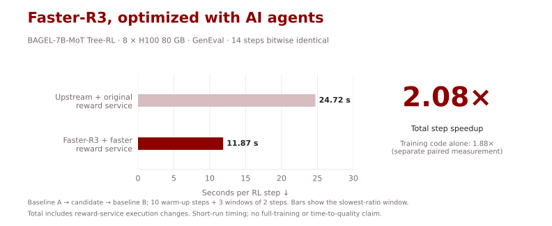
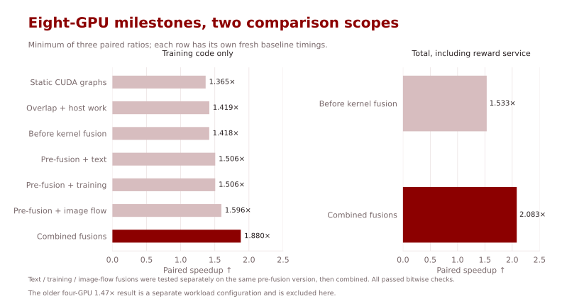
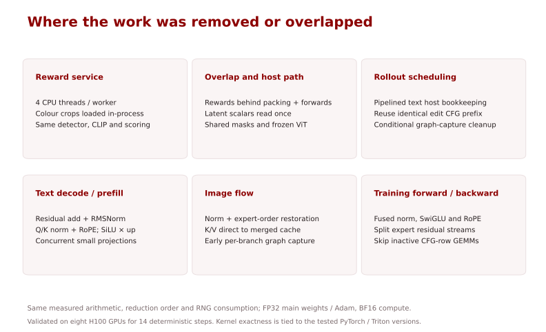
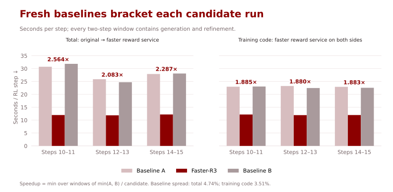

# Faster-R3

[English](README.md) | [简体中文](README.zh-CN.md)

**2.08× faster R3 Tree-RL steps for BAGEL-7B-MoT on 8 NVIDIA H100 80 GB GPUs, with bitwise-identical records over 14 checked steps, optimized by AI agents.**



| Implementation | Seconds per RL step, windows 1 / 2 / 3 ↓ | Minimum paired speedup ↑ |
|---|---:|---:|
| Baseline | 30.73 / 24.72 / 27.91 | 1.00× |
| **Faster-R3** | **11.99 / 11.87 / 12.20** | **2.0831×** |

The headline **includes the GenEval reward-service execution improvements**. A separate paired measurement with the faster reward configuration on both sides gives **1.8803× for the training code alone**. Both are directly measured; they are not multiplied estimates. Baseline entries above use the faster of baseline A and B in each window.

Measured on one host with eight H100 GPUs, FSDP2 ZeRO-3, BF16 compute, FP32 main weights and Adam state, group size 16 over policy groups of 4, and the real GenEval reward workers sharing the training GPUs. No precision change or FP8. An RL step comprises rollout, reward and one optimizer update; generate and reflect-and-refine steps alternate. Each timed launch runs 16 steps: 10 warm-up steps, then three two-step windows. The headline is the smallest paired ratio (2.5636 / 2.0831 / 2.2869), not full-training throughput or time to quality.

## Quick Start

Prepare the [training environment, public BAGEL checkpoint and GenEval reward server](docs/training.md). Fusion paths are enabled by default. Start the reward server in its own environment:

```bash
cd /path/to/reward-server
# Eight workers, four OpenMP/MKL threads each, in-process colour crops.
gunicorn -c /path/to/Faster-R3/scripts/reward/gunicorn_geneval.py "app_geneval:create_app()"
```

Then, from Faster-R3 in the training environment:

```bash
export MODEL_PATH=/path/to/BAGEL-7B-MoT
export LOG_DIR=/path/to/output
export REWARD_URL=http://127.0.0.1:18085
bash scripts/train_faster_r3_geneval.sh
```

The launcher uses eight ranks, eight shards, an eight-prompt step-0 evaluation fixture, and the shared [ZeRO-3/loading adapter](scripts/h100_adapt.py). Tested kernels depend on PyTorch 2.9.1, Triton 3.5.1 and flash-attn 2.5.8. The portable launcher is a packaging of the measured recipe; it has not itself been rerun end to end. See [baseline reproduction and memory requirements](docs/training.md#launch).

## Agent Optimization History

The latest completed tree is **fusion_b**, source commit `1367ad7`. It combines the earlier static CUDA graphs with reward overlap, host-path work and three groups of bit-exact fused kernels.



The earlier **1.4709× on four GPUs** is retained in the [historical report](docs/history-4gpu.md). It used different hardware, sharding and batch composition and is not a point on the eight-GPU curve.

## What changed

- **Reward service and overlap:** cap eight workers at four OpenMP/MKL threads each and load colour crops in-process. Submit rewards as before, then run packing and the reference/policy forwards while waiting; resolve rewards and advantages before computing the loss.
- **Host work and redundant computation:** read latent scalars once per latent rather than once per token; reuse shared image transforms, block masks and frozen ViT outputs. Keep the original packed layout while skipping expert GEMMs for CFG-copy rows whose outputs do not contribute to the loss.
- **Rollout scheduling:** pipeline text decoding with host bookkeeping, reuse the identical edit CFG image prefix, and capture static graphs without unconditional allocator flushing when enough memory is available.
- **Text fusion:** RMSNorm with optional residual add, Q/K norm plus RoPE, and SiLU × up; reuse layer-invariant indexes and overlap small independent projections.
- **Image-flow fusion:** normalize and restore expert order together, write K/V directly into merged caches, fuse residual/norm/MLP work, and capture each CFG branch after its first call.
- **Training fusion:** RMSNorm, SwiGLU and RoPE forward/backward kernels, plus a per-expert residual layout that avoids repeated gathers, zero-filled buffers and scatters.



The fused reductions reproduce the tested PyTorch reduction order, BF16 rounding boundaries and non-flushing division behavior. The production code under `modeling/` and `train/` is byte-for-byte identical to the measured snapshot; [source hashes and aggregate results](docs/validation/h100.json) accompany this release. See the [switches and source map](docs/training.md#changes-and-switches).

## Validation

**Bitwise:** `fusion_b_total2` and `fusion_b_r` both passed all recorded comparisons for deterministic steps 0–13 on all eight ranks: training losses/statistics, rewards, advantages, rollout token/image hashes, gradient norms, learning rates, and final parameter/Adam digests. Rank-0 final digest: `7ee0e76bcc53ddd6b5b8d905bb99a861302d2bba9829699f101a43bd99f4d41a`.

**Publication check:** the portable diagnostics were rerun on one H100: 37 training-operator cases and 169 flow cases passed. These supplement the archived eight-rank result; they do not repeat it. [Validation receipt](docs/validation/publication-check.json).

**Timing:** fresh baseline A → candidate → baseline B launches on the same host. Total-run baseline spread was 4.74%; training-code-only spread was 3.51%. Both conservative speedups clear the corresponding `max(1.02, 1 + 2 × spread)` benefit threshold.



**Acceptance and scope:** the completed bit-exact checks satisfy this release's numerical acceptance criterion. Additional long-training consistency checks are not required. The observed scope is 14 deterministic steps on all eight ranks. Production-mode timing values were not compared numerically. The rank-0 wandb hook recorded empty lists, so evaluation-only metrics were not validated. Memory remains tight; the new eight-GPU result is a speed improvement, not a memory-saving claim. Full judge records, weights, generated images and profiler traces are not bundled. See [the judge and memory table](docs/judge.md).

## Current endpoint

This release publishes the latest completed, directly measured milestone, **2.0831× total / 1.8803× training code alone**. Further scheduling or numerical changes need fresh paired timings and numerical validation. The current release is accepted under the bit-exact criterion.

## More AI4AI-for-Anything projects

[Faster-BAGEL](https://github.com/AI4AI-for-Anything/Faster-BAGEL) · [Faster-YOCO](https://github.com/AI4AI-for-Anything/Faster-YOCO) · [Faster-JiT](https://github.com/AI4AI-for-Anything/Faster-JiT) · [Faster-RAE](https://github.com/AI4AI-for-Anything/Faster-RAE) · [Faster-LLaVA](https://github.com/AI4AI-for-Anything/Faster-LLaVA) · [Faster-DMD](https://github.com/AI4AI-for-Anything/Faster-DMD) · [Faster-SelfForcing](https://github.com/AI4AI-for-Anything/Faster-SelfForcing)

## Upstream R3 documentation

Based on [sen-ye/R3](https://github.com/sen-ye/R3) at `761b0b0`, the code of *Understanding vs. Generation: Navigating Optimization Dilemma in Multimodal Models*. [Apache-2.0 license](LICENSE). The `upstream` branch holds the original code; installation, tutorial and citation remain in [README.upstream.md](README.upstream.md).
