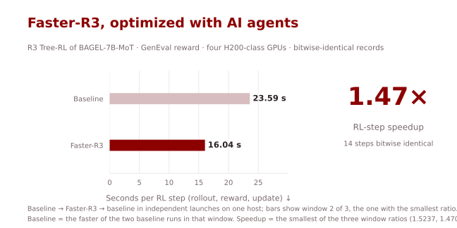
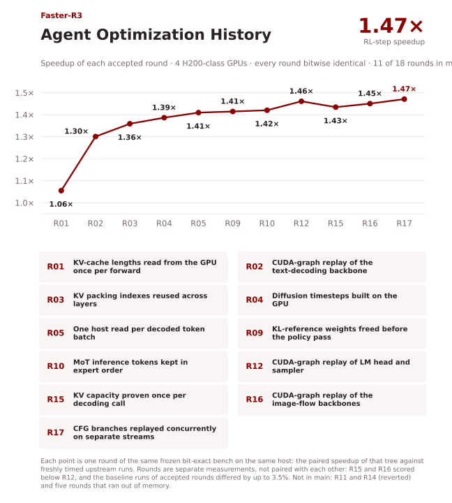
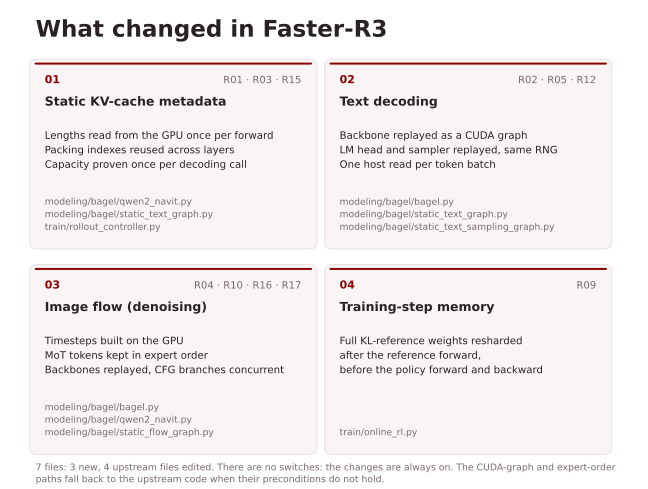
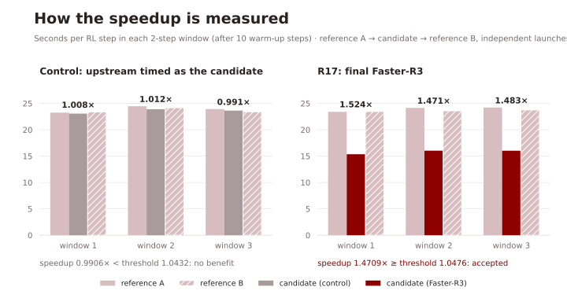

# Faster-R3

[English](README.md) | [简体中文](README.zh-CN.md)

**AI agent 优化的 BAGEL-7B-MoT R3 Tree-RL 训练：在 4 张 H200 级 GPU 上每个 RL 步加速 1.47×，训练记录逐位一致。**



| 实现 | 每个 RL 步耗时（秒），窗口 1 / 2 / 3 ↓ | 加速比 ↑ |
|---|---:|---:|
| 基线（两次基线运行中较快的一次） | 23.40 / 23.59 / 23.76 | 1.00× |
| **Faster-R3** | **15.36 / 16.04 / 16.03** | **1.47×** |

在 **4 张 H200 级 GPU**（Hopper，每卡约 140 GiB）上测得，使用上游 R3 的 GenEval 奖励配方：BAGEL-7B-MoT（146.1 亿参数）用 Tree-RL 训练（文本推理部分用 GRPO，图像去噪部分用 Mix-GRPO），生成步与反思-精修步交替进行，每组 16 个样本、4 张卡组成一个策略组，FSDP2 采用上游的分片方式，BF16 计算，真实的 GenEval 奖励服务和训练共用这 4 张卡，**不使用 FP8，也没有改任何精度**。一个 RL 步包括一次 rollout、它的奖励计算和一次优化器更新。基线、Faster-R3、基线依次在同一台机器上独立启动；每次运行先跑 10 步预热，再测三个窗口，每个窗口两步（一个生成步和一个精修步）。加速比取三个窗口比值（1.5237、1.4709、1.4827）中最小的一个：**1.4709×**。这是 16 步短运行的每步耗时对比，不是完整训练的耗时。

测速之前，同一份代码先从发布的检查点训练了 **14 步**，4 个 rank 上记录的每个值都和上游代码**逐位一致**：loss、奖励、优势值、rollout 生成的 token 和图像、梯度范数、学习率，以及最后一步之后每个参数分片和 Adam 状态的摘要。测速运行中，每卡峰值分配显存从 131.0 GiB 降到 104.8 GiB（预留显存 133.7 GiB 对 130.7 GiB）。

## 快速开始

先准备[环境、BAGEL-7B-MoT 检查点和 GenEval 奖励服务](docs/training.md)。这些改动不需要开关：本仓库的代码就是上游训练代码，改动始终生效。启动脚本运行测速时用的 4 卡 GenEval 配方：

```bash
export MODEL_PATH=/path/to/BAGEL-7B-MoT
export LOG_DIR=/path/to/output
export REWARD_URL=http://127.0.0.1:18085   # GenEval 奖励服务，见 docs/training.md#reward-server
bash scripts/train_faster_r3_geneval.sh
```

参数就是上游 `scripts/train_rl.sh` 的参数，加上[记录在案的改动项](docs/training.md#launch)（4 张卡、`--num_shard 4`、上游教程里的 GenEval 数据和奖励、4 条提示词的验证文件）。跑基线时，在 `upstream` 分支上运行同样的命令。只在 **PyTorch 2.9.1（CUDA 12.8 wheel）、Triton 3.5.1、flash-attn 2.5.8 和 transformers 4.46.2**（上游指定的版本）上测试过，4 张卡。

## Agent 优化过程

图中每个点都是同一台机器上、同一个冻结的逐位一致测试台的一轮结果，4 张 H200 级 GPU。



## 主要改动

R3 每一步有相当一部分时间花在 rollout 上：文本推理逐个 token 解码，图像去噪时每个去噪步最多有三个无分类器引导（CFG）分支。大部分轮次去掉的是这里的主机端开销：从 GPU 读标量造成的同步，以及大量小 kernel 的发射。

- **静态 KV cache 元数据：** 静态 KV cache 里每条序列的长度，每次前向只拷到主机一次，不再在每一层里做好几次 `.item()` 同步；长度不变期间，整数打包索引只算一次，所有层和所有去噪步共用；每次解码调用开始时做一次检查，证明 cache 不会溢出，之后逐 token 的主机端检查就省掉了。
- **文本解码：** 每种活跃 batch 形状的解码器主干，第一次照常执行，之后捕获成 CUDA graph，后面的 token 直接重放；LM head 和 top-k 采样也这样重放，随机数生成器注册到 graph 上，消耗的 Philox 偏移和原来的逐个 kernel 执行完全相同。token 的记账每批只从 GPU 读一次，不再逐个标量读。
- **图像流（去噪）：** 时间步直接在 GPU 上展开，不再由主机标量重建；无梯度生成时，混合 transformer（MoT）层把文本 token 和图像 token 按专家顺序排好，不再在每个子模块里 gather 和 scatter；每个 CFG 分支的只读 LM 主干在每次图像生成调用内捕获成 CUDA graph，后面的去噪步直接重放，几个相互独立的分支在不同的 stream 上并发重放，在原样不动的 CFG 计算之前汇合。
- **训练步显存：** 冻结的 KL 参考模型做完前向后立刻把完整权重重新分片释放，再做策略模型的前向和反向。峰值分配显存因此降了约 27 GiB，也给按专家排序的布局腾出了空间。



详见[改动表](docs/training.md#changes)。这些改动的目标是不改变任何一个数（同样的运算、同样的求和顺序、同样的随机数消耗），测试台在检查的 14 步上证实了这一点。没有开关；CUDA graph 路径和按专家排序的路径在前提条件不满足时会退回上游代码。

## 正确性验证

**逐位一致检查。** 每一轮都由一个[冻结的逐位一致测试台](docs/judge.md)判定，它在第一轮优化之前就已建好。候选版本在 4 张卡上从发布的 BAGEL-7B-MoT 检查点训练第 0–13 步（种子 4396，开启 PyTorch 确定性算法），记录的每个值都必须和未修改的上游代码的记录相同；上游代码事先在同一台机器上跑了两次，结果逐位相同：

- 每一步、每个 rank：文本和图像的原始 loss、额外统计量、裁剪前的梯度范数、学习率、rollout token id 的哈希和每张生成图像的哈希、GenEval 奖励（得分、总奖励、格式奖励），以及文本和图像的优势值；
- 最后一步之后：每个本地参数分片和每个 Adam 状态张量的 SHA-256。

Faster-R3（`e71a7bd`）全部相同；rank 0 的最终摘要和基线一致（`c2b02b63…`）。只有逐位一致的版本才会测速。把未修改的上游代码当作候选来测，得到 0.9906×，低于阈值 1.0432，符合“没有改动就没有收益”的预期。

**局限。** 检查只覆盖确定性模式下的 14 步；测速运行用的是正式设置，那时的数值没有比对。测试台本来还要比对 rank 0 的 `wandb.log` 记录值，但 `wandb.init` 替换掉了它的钩子，两边记录到的都是空列表；上面列出的训练数值仍然是直接比对的，这一项由这次运行的监督方豁免（[详情](docs/judge.md#known-gap-wandb-values)）。第 0 步的评测只记在 wandb 里，所以评测奖励没有比对。没有测试长时间训练、其他数据集（GenEval++、TIIF）和 8 卡配置。



## 为什么停在 1.47×

目标是 2×，没有达到。第 17 轮之后，负责人结束了逐位一致这条线，把后续工作拆成只优化 rollout 和只优化训练两条线，所以这里**不声称已到上限**。显存限制了好几个方向：基线每卡已经分配 131 GiB（每卡约 140 GiB），同卡的 GenEval 奖励进程还要再占约 3.9 GiB。有五个候选显存不够：三个让更多权重或激活常驻（第 6、6b、13 轮），一个提前释放梯度（第 7 轮），还有一个是第 9 轮释放显存之前的按专家排序布局（第 8 轮）。第 11 轮逐位一致，但测速时两次基线运行相差 27%，阈值随之升到 1.54×，因此被撤回。第 14 轮以 1.45× 通过（低于第 12 轮），但多分配约 10.7 GiB 显存，所以没有放进最终版本。最后一次完整的 profile 是第 16 轮的，在第 17 轮之前。

详见[没有采用的轮次](docs/training.md#not-adopted)和[判卷记录](docs/judge.md)。

## AI4AI-for-Anything 的其他项目

[Faster-BAGEL](https://github.com/AI4AI-for-Anything/Faster-BAGEL) · [Faster-YOCO](https://github.com/AI4AI-for-Anything/Faster-YOCO) · [Faster-JiT](https://github.com/AI4AI-for-Anything/Faster-JiT) · [Faster-RAE](https://github.com/AI4AI-for-Anything/Faster-RAE) · [Faster-LLaVA](https://github.com/AI4AI-for-Anything/Faster-LLaVA) · [Faster-DMD](https://github.com/AI4AI-for-Anything/Faster-DMD) · [Faster-SelfForcing](https://github.com/AI4AI-for-Anything/Faster-SelfForcing)

## 上游 R3 文档

基于 [sen-ye/R3](https://github.com/sen-ye/R3) 的 `761b0b0`，即论文 [Understanding vs. Generation: Navigating Optimization Dilemma in Multimodal Models](https://arxiv.org/abs/2602.15772) 的代码。[Apache-2.0 许可证](LICENSE)。`upstream` 分支保存未修改的代码。原始 README 保存在 [README.upstream.md](README.upstream.md)，也附在下面。

<details>
<summary>原始 R3 README：概述、安装、用法、引用</summary>

# Understanding VS. Generation: Navigating Optimization Dilemma in Multimodal Models

This repository contains the code for the paper [Understanding VS. Generation: Navigating Optimization Dilemma in Multimodal Models](https://arxiv.org/abs/2602.15772)

> **Understanding VS. Generation: Navigating Optimization Dilemma in Multimodal Models**   
> Sen Ye, Mengde Xu, Shuyang Gu, Di He, Liwei Wang, Han Hu   
> PKU, Tencent 


## Overview
We propose the **Reason-Reflect-Refine (R3)** framework. R3 re-frames the single-step generation process into a multi-step process of "generate-understand-regenerate". We optimize R3 with **Tree-RL** strategy, which simultaneously optimizes model's generation and understanding capabilities.

This repository contains the code for training Bagel model with R3 framework. We utilize **Tree-RL** to split the rollout process into multiple stages. We adopt GRPO to optimize the text reasoning process and Mix-GRPO to optimize the diffusion process.


## Installation
```bash
conda create -n bagel_r3 python=3.10 -y
conda activate bagel_r3
pip install -r requirements.txt
pip install flash_attn==2.5.8 --no-build-isolation
```

Download the model checkpoint from [Hugging Face](https://huggingface.co/ByteDance-Seed/BAGEL-7B-MoT) and place it in the `checkpoints` directory.


## Usage
We provide a doc in tutorial.md detailing how to train R3 on various datasets.

## Citation
If you find this work useful, please consider citing:
```bibtex
@misc{ye2026understandingvsgenerationnavigating,
      title={Understanding vs. Generation: Navigating Optimization Dilemma in Multimodal Models}, 
      author={Sen Ye and Mengde Xu and Shuyang Gu and Di He and Liwei Wang and Han Hu},
      year={2026},
      eprint={2602.15772},
      archivePrefix={arXiv},
      primaryClass={cs.CV},
      url={https://arxiv.org/abs/2602.15772}, 
}
```

</details>
